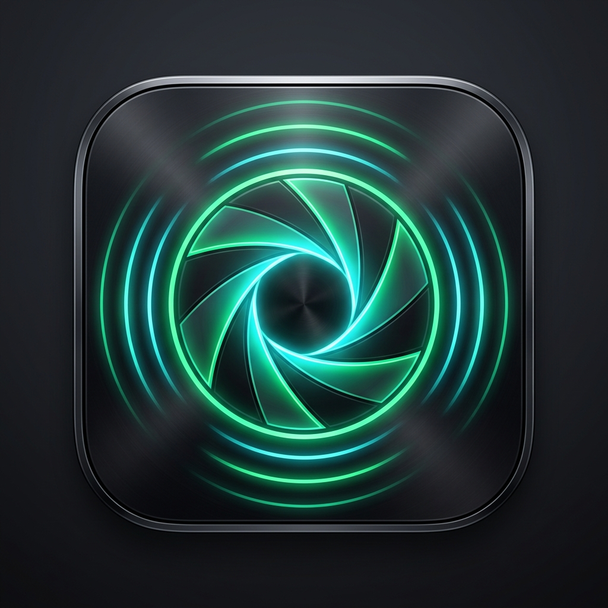

<p align="center">
  
</p>

<h1 align="center">PhoCast</h1>

<p align="center">
  <strong>High-Performance, Zero-Latency Smartphone Webcam Bridge for PC & OBS Studio</strong>
</p>

<p align="center">
  <a href="https://github.com/otattt/PhoCast/releases/latest"></a>
  <a href="https://github.com/otattt/PhoCast/blob/main/LICENSE"></a>
  
</p>

---

## 📥 Direct Downloads (v1.0.0)

No extraction or unzipping needed! Download the raw files directly:

| Platform | File | Description | Download |
| :--- | :--- | :--- | :--- |
| 📱 **Android** | `PhoCast-v1.0.0.apk` | Phone camera streamer app (APK) | [**Download APK**](https://github.com/otattt/PhoCast/releases/download/v1.0.0/PhoCast-v1.0.0.apk) |
| 💻 **Windows** | `PhoCast-Setup-v1.0.0.exe` | **All-in-One Installer** (Client + DirectShow Driver) | [**Download Installer**](https://github.com/otattt/PhoCast/releases/download/v1.0.0/PhoCast-Setup-v1.0.0.exe) |
| 📦 **Windows** | `PhoCast.exe` | Standalone portable client | [**Download Portable**](https://github.com/otattt/PhoCast/releases/download/v1.0.0/PhoCast.exe) |

---

## ✨ Features

- ⚡ **Zero-Latency Streaming:** Uses custom bulk memory transfers and real-time drop-frame policy over USB (ADB) or local Wi-Fi to eliminate queueing delay.
- 🎯 **Crisp 1080p Full HD:** CameraX 1.3 `ResolutionSelector` guarantees native high-resolution capture on Google Pixel and modern Android phones.
- 🧊 **Keep-Cool Mode (AMOLED Screen Off):** Turns the smartphone screen 100% black and halts local GPU rendering during streams, keeping the device cool to the touch and preserving battery life.
- 🎥 **OBS Studio Direct Integration:** Bundles a native DirectShow virtual camera driver so OBS Studio immediately detects `PhoCast Camera` under **Video Capture Device**. Also works out-of-the-box in Discord, Zoom, and Google Meet.
- 🖥️ **Native Windows Client:** Built with Rust and OpenGL GUI (`eframe/glow`)—lightweight (~15 MB RAM), instant startup, no black CMD console windows.
- 🔒 **100% Local & Private:** Direct socket connection on your local machine and Wi-Fi—no cloud servers, no user accounts, no telemetry.

---

## 🚀 Quick Start Guide

### Step 1: Install PhoCast on Your Phone
1. Download [**`PhoCast-v1.0.0.apk`**](https://github.com/otattt/PhoCast/releases/download/v1.0.0/PhoCast-v1.0.0.apk) directly on your Android phone and install it.
2. Grant camera permissions when prompted.
3. Choose your preferred resolution (`1080p`, `720p`, or `480p`) and frame rate (`30 FPS` or `60 FPS`).
4. Tap **START STREAM**.

### Step 2: Install PhoCast on Your PC
1. Run [**`PhoCast-Setup-v1.0.0.exe`**](https://github.com/otattt/PhoCast/releases/download/v1.0.0/PhoCast-Setup-v1.0.0.exe).
2. The installer automatically registers the **PhoCast Camera** DirectShow driver silently and places a desktop shortcut.

### Step 3: Connect & Stream

#### Option A: USB Mode (Recommended for Zero Latency)
1. Connect your phone via USB cable and ensure **USB Debugging** is enabled in Developer Options.
2. Open **PhoCast Client** on PC, select the **USB (ADB)** tab.
3. Click **START STREAM**.

#### Option B: Wi-Fi Mode
1. Ensure PC and phone are on the same Wi-Fi network.
2. Enter the IP address shown on the phone screen into the **Wi-Fi** tab in PhoCast PC client.
3. Click **START STREAM**.

### Step 4: Use in OBS Studio / Discord / Zoom
* In **OBS Studio**, add a new source: **Video Capture Device** -> select **`PhoCast Camera`**.
* The live video stream will instantly display at full 1080p resolution!

---

## 🛠️ Architecture

```
[ Android Smartphone ]
      │ (CameraX 1.3 1080p YUV_420_888)
      ▼
 [ Fast Bulk NV21 Converter ]  <-- ~2ms processing time
      │ (JPEG 85% Quality)
      ▼
[ TCP Streamer (Port 5000) ]  <-- Atomic drop-frame policy (Zero buffer bloat)
      │
      │  (USB ADB / Wi-Fi LAN)
      ▼
[ Windows Client (Rust) ]     <-- eframe / glow native UI
      │
      ├──> [ DirectShow Driver ]  --> OBS Studio (Video Capture Device)
      └──> [ VirtualCam Bridge ]  --> Zoom / Google Meet / Discord
```

---

## 📄 License
Released under the [MIT License](LICENSE).
